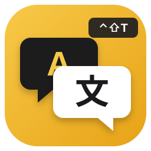
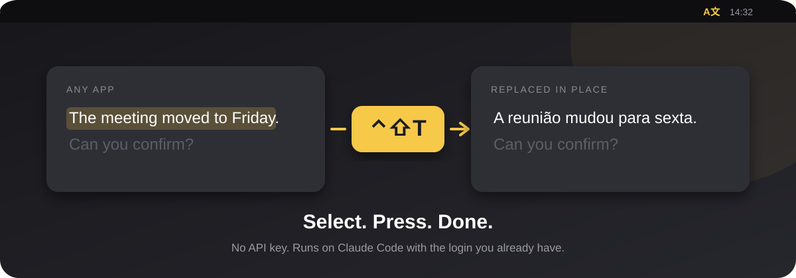

<p align="center">
  
</p>

<h1 align="center">TraduzaJa</h1>

<p align="center">
  <b>Select text anywhere on your Mac, press ⌃⇧T, and it is replaced by the translation.</b><br/>
  No copy, no paste, no switching windows. No API key.
</p>

<p align="center">
  
  
  
  
  
</p>

<p align="center">
  
</p>

---

## How it works

TraduzaJa lives in the menu bar. It reads your selection through Accessibility, sends it to Claude through [Claude Code](https://claude.com/claude-code) using the login you already have, and pastes the result back over the selection. Nothing to configure, no key to rotate, no usage dashboard to watch.

## Shortcuts

| Shortcut | What it does |
|---|---|
| **⌃⇧T** | Translate English ↔ your language |
| **⌃⇧G** | Fix grammar and spelling |
| **⌃⇧F** | Make it more formal |
| **⌃⇧C** | Make it more casual |
| **⌃⇧E** | Explain the sentence |

With nothing selected, **G / F / C** act on the line under the cursor. The shortcuts use ⌃⇧ on purpose: ⌘⇧T is taken by every browser.

## It also teaches you

| | |
|---|---|
| **Lesson card** | Every correction shows what was wrong, in a small card at the top of the screen. |
| **Flashcard review** | Your mistakes go into a history you can review until they stop repeating. |
| **Your language, your model** | Pick the target language and the model (Haiku for speed, Sonnet, Opus) from the menu. |
| **Small conveniences** | Translate the clipboard, see the last translation, open at login. |
| **Private by default** | The windows are hidden from screen sharing and screenshots. |

## Install

Requirements: macOS 14 or newer, Xcode, [xcodegen](https://github.com/yonaskolb/XcodeGen), and [Claude Code](https://claude.com/claude-code) logged in (`claude` on your PATH).

```sh
git clone https://github.com/datamonkeys/TraduzaJa.git
cd TraduzaJa
make run
```

`make run` builds, installs to `/Applications` and opens the app. The first time, allow TraduzaJa in **System Settings › Privacy & Security › Accessibility** so it can read the selection and paste the result.

## Develop

```sh
make test                      # core tests
TRADUZA_LIVE=1 swift test      # also calls Claude for real
make xcodeproj                 # regenerate the Xcode project from project.yml
```

| Folder | What lives there |
|---|---|
| `Sources/TraduzaCore` | Translator and history. Plain Swift, fully testable. |
| `Sources/TraduzaJa` | Menu bar app, hotkeys, selection handling, lesson card, review window. |
| `Tests/TraduzaCoreTests` | Unit tests for the core. |
| `project.yml` | Source of truth for the Xcode project. |

## Why we built it

We write in English and Portuguese all day and were tired of the copy, paste, translate, paste back loop. We built TraduzaJa between client projects at [datamonkeys](https://datamonkeys.ai), and it stuck.

## License

[MIT](LICENSE)

<p align="center"><sub>Built by <a href="https://datamonkeys.ai">datamonkeys</a>. Have an idea you can't stop thinking about? Let's build it.</sub></p>
